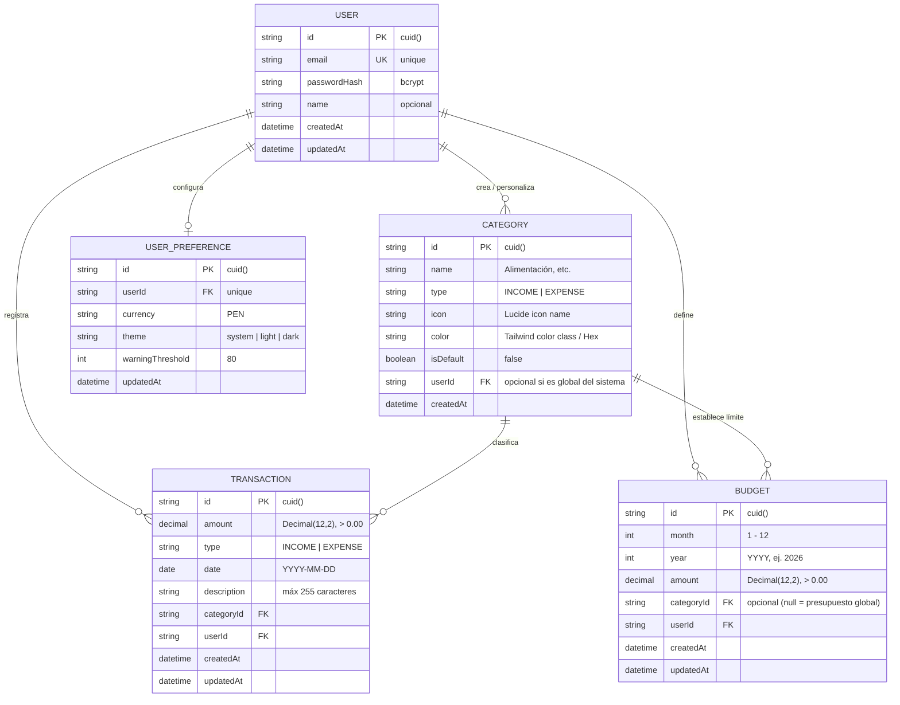
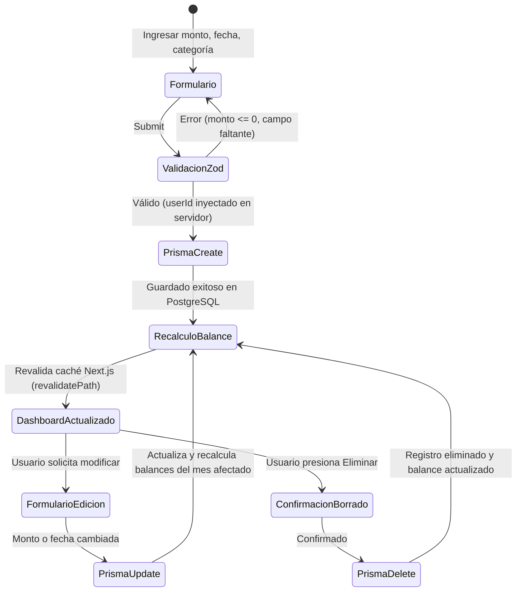

# Data Model: Personal Finance Tracker

**Feature**: `001-personal-finance-tracker`  
**Date**: 2026-10-27  
**Database**: PostgreSQL 16 (vía Prisma ORM)  

---

## 1. Diagrama Entidad-Relación



---

## 2. Definición Detallada de Entidades

### Entidad 1: `User`
Representa la cuenta de acceso de la persona titular de los registros financieros.

| Campo | Tipo PostgreSQL | Prisma | Restricciones / Validación | Descripción |
| :--- | :--- | :--- | :--- | :--- |
| `id` | `VARCHAR(30)` | `String @id @default(cuid())` | Clave primaria | Identificador único del usuario |
| `email` | `VARCHAR(255)` | `String @unique` | Email válido, min 5 caracteres | Correo electrónico de inicio de sesión |
| `passwordHash`| `VARCHAR(255)` | `String` | Hash bcrypt (longitud 60) | Contraseña protegida |
| `name` | `VARCHAR(100)` | `String?` | Opcional, máx 100 caracteres | Nombre preferido para mostrar |
| `createdAt` | `TIMESTAMP(3)` | `DateTime @default(now())`| Not Null | Fecha de alta de la cuenta |
| `updatedAt` | `TIMESTAMP(3)` | `DateTime @updatedAt` | Not Null | Última actualización |

---

### Entidad 2: `UserPreference`
Configuraciones personalizadas de la experiencia de usuario.

| Campo | Tipo PostgreSQL | Prisma | Restricciones / Validación | Descripción |
| :--- | :--- | :--- | :--- | :--- |
| `id` | `VARCHAR(30)` | `String @id @default(cuid())` | Clave primaria | Identificador único |
| `userId` | `VARCHAR(30)` | `String @unique` | FK $\rightarrow$ `User(id)` `ON DELETE CASCADE` | Usuario asociado |
| `currency` | `VARCHAR(5)` | `String @default("PEN")` | ISO 4217 ("PEN") | Moneda base del sistema |
| `theme` | `VARCHAR(10)` | `String @default("system")` | `"light" \| "dark" \| "system"` | Preferencia visual |
| `warningThreshold` | `INT` | `Int @default(80)` | Rango 50 a 95 | Umbral porcentual de alerta preventiva |

---

### Entidad 3: `Category`
Catálogo de clasificación de movimientos financieros.

| Campo | Tipo PostgreSQL | Prisma | Restricciones / Validación | Descripción |
| :--- | :--- | :--- | :--- | :--- |
| `id` | `VARCHAR(30)` | `String @id @default(cuid())` | Clave primaria | Identificador único |
| `name` | `VARCHAR(50)` | `String` | Min 2, máx 50 caracteres | Nombre descriptivo |
| `type` | `VARCHAR(10)` | `TransactionType` | `"INCOME" \| "EXPENSE"` | Tipo de movimiento que clasifica |
| `icon` | `VARCHAR(50)` | `String?` | Identificador Lucide válido | Icono visual representativo |
| `color` | `VARCHAR(30)` | `String?` | Código Hex o token Tailwind | Color distintivo para gráficos |
| `isDefault` | `BOOLEAN` | `Boolean @default(false)` | Booleano | Si es una categoría del sistema |
| `userId` | `VARCHAR(30)` | `String?` | FK $\rightarrow$ `User(id)` `ON DELETE CASCADE` | Propietario (null si es categoría base) |

* **Regla de unicidad**: `@@unique([name, userId, type])` para evitar categorías duplicadas con el mismo nombre y tipo para un mismo usuario.
* **Integridad referencial con Transacciones**: `onDelete: Restrict` en transacciones para bloquear el borrado accidental si existen movimientos asociados.

---

### Entidad 4: `Transaction`
Movimiento individual de dinero (ingreso o gasto) registrado por el usuario.

| Campo | Tipo PostgreSQL | Prisma | Restricciones / Validación | Descripción |
| :--- | :--- | :--- | :--- | :--- |
| `id` | `VARCHAR(30)` | `String @id @default(cuid())` | Clave primaria | Identificador de transacción |
| `amount` | `DECIMAL(12, 2)` | `Decimal @db.Decimal(12, 2)`| Estrictamente $> 0.00$, máx 2 decimales | Importe monetario en Soles (PEN) |
| `type` | `VARCHAR(10)` | `TransactionType` | `"INCOME" \| "EXPENSE"` | Sentido contable |
| `date` | `DATE` | `DateTime @db.Date` | Fecha válida YYYY-MM-DD | Fecha del movimiento |
| `description`| `VARCHAR(255)`| `String?` | Máx 255 caracteres | Detalle opcional de la compra o ingreso |
| `categoryId`| `VARCHAR(30)` | `String` | FK $\rightarrow$ `Category(id)` `ON DELETE RESTRICT`| Categoría asignada |
| `userId` | `VARCHAR(30)` | `String` | FK $\rightarrow$ `User(id)` `ON DELETE CASCADE` | Propietario del registro |
| `createdAt` | `TIMESTAMP(3)` | `DateTime @default(now())`| Not Null | Marca de tiempo de creación |
| `updatedAt` | `TIMESTAMP(3)` | `DateTime @updatedAt` | Not Null | Marca de tiempo de edición |

* **Índices de rendimiento**:
  * `@@index([userId, date])`: Para acelerar las consultas del panel principal y filtros de fecha del mes actual.
  * `@@index([userId, categoryId])`: Para agrupar sumatorias de gastos por categoría instantáneamente.

---

### Entidad 5: `Budget`
Objetivo de control o techo de gasto para un mes determinado.

| Campo | Tipo PostgreSQL | Prisma | Restricciones / Validación | Descripción |
| :--- | :--- | :--- | :--- | :--- |
| `id` | `VARCHAR(30)` | `String @id @default(cuid())` | Clave primaria | Identificador de presupuesto |
| `month` | `SMALLINT` | `Int` | Rango `1` a `12` | Mes de calendario |
| `year` | `INT` | `Int` | Rango `2000` a `2100` | Año del presupuesto |
| `amount` | `DECIMAL(12, 2)` | `Decimal @db.Decimal(12, 2)`| Estrictamente $> 0.00$ | Límite máximo asignado (PEN) |
| `categoryId`| `VARCHAR(30)` | `String?` | FK $\rightarrow$ `Category(id)` `ON DELETE CASCADE`| Opcional: si es null = global |
| `userId` | `VARCHAR(30)` | `String` | FK $\rightarrow$ `User(id)` `ON DELETE CASCADE` | Propietario del presupuesto |
| `createdAt` | `TIMESTAMP(3)` | `DateTime @default(now())`| Not Null | Fecha de creación |
| `updatedAt` | `TIMESTAMP(3)` | `DateTime @updatedAt` | Not Null | Última modificación |

* **Regla de unicidad**: `@@unique([userId, month, year, categoryId])` — sólo puede existir un presupuesto para una misma categoría (o presupuesto global) en un mes determinado.

---

## 3. Esquema Prisma Declarativo (`schema.prisma`)

```prisma
datasource db {
  provider = "postgresql"
  url      = env("DATABASE_URL")
}

generator client {
  provider = "prisma-client-js"
}

enum TransactionType {
  INCOME
  EXPENSE
}

model User {
  id            String          @id @default(cuid())
  email         String          @unique
  passwordHash  String
  name          String?
  createdAt     DateTime        @default(now())
  updatedAt     DateTime        @updatedAt

  preference    UserPreference?
  categories    Category[]
  transactions  Transaction[]
  budgets       Budget[]
}

model UserPreference {
  id               String   @id @default(cuid())
  userId           String   @unique
  user             User     @relation(fields: [userId], references: [id], onDelete: Cascade)
  currency         String   @default("PEN")
  theme            String   @default("system")
  warningThreshold Int      @default(80)
  updatedAt        DateTime @updatedAt
}

model Category {
  id           String          @id @default(cuid())
  name         String
  type         TransactionType
  icon         String?
  color        String?
  isDefault    Boolean         @default(false)
  userId       String?
  user         User?           @relation(fields: [userId], references: [id], onDelete: Cascade)

  transactions Transaction[]
  budgets      Budget[]

  @@unique([name, userId, type])
}

model Transaction {
  id          String          @id @default(cuid())
  amount      Decimal         @db.Decimal(12, 2)
  type        TransactionType
  date        DateTime        @db.Date
  description String?
  categoryId  String
  category    Category        @relation(fields: [categoryId], references: [id], onDelete: Restrict)
  userId      String
  user        User            @relation(fields: [userId], references: [id], onDelete: Cascade)
  createdAt   DateTime        @default(now())
  updatedAt   DateTime        @updatedAt

  @@index([userId, date])
  @@index([userId, categoryId])
}

model Budget {
  id         String    @id @default(cuid())
  month      Int
  year       Int
  amount     Decimal   @db.Decimal(12, 2)
  categoryId String?
  category   Category? @relation(fields: [categoryId], references: [id], onDelete: Cascade)
  userId     String
  user       User      @relation(fields: [userId], references: [id], onDelete: Cascade)
  createdAt  DateTime  @default(now())
  updatedAt  DateTime  @updatedAt

  @@unique([userId, month, year, categoryId])
}
```

---

## 4. Ciclo de Vida y Transiciones de Estado

### A. Registro, Edición y Eliminación de Transacciones


### B. Gestión Mensual de Presupuestos
* **Cambio de mes**: Al ingresar a un nuevo mes de calendario, el sistema lee la configuración de presupuestos del mes anterior para pre-poblar los límites base del nuevo período, iniciando el gasto consumido en `S/ 0.00`.
* **Cálculo de alertas en tiempo de ejecución**:
  * $\text{Gasto} < 80\% \times \text{Límite}$: Estado `NORMAL` (barra verde / azul neutra).
  * $80\% \le \text{Gasto} < 100\% \times \text{Límite}$: Estado `WARNING` (barra ámbar + aviso preventivo).
  * $\text{Gasto} \ge 100\% \times \text{Límite}$: Estado `OVERDRAFT` (barra roja + alerta crítica con monto exacto de exceso).
