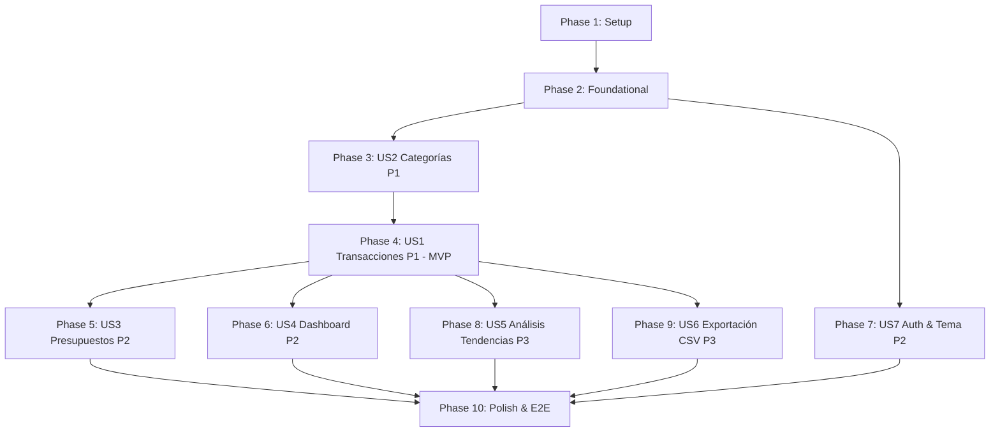

# Tasks: Sistema de Gestión de Finanzas Personales

**Feature**: `001-personal-finance-tracker`  
**Input**: [spec.md](file:///c:/Users/Usuario/Desktop/Code/spec-kit/specs/001-personal-finance-tracker/spec.md), [plan.md](file:///c:/Users/Usuario/Desktop/Code/spec-kit/specs/001-personal-finance-tracker/plan.md), [data-model.md](file:///c:/Users/Usuario/Desktop/Code/spec-kit/specs/001-personal-finance-tracker/data-model.md), [contracts/](file:///c:/Users/Usuario/Desktop/Code/spec-kit/specs/001-personal-finance-tracker/contracts/)

---

## Phase 1: Setup (Shared Infrastructure)

**Purpose**: Inicialización del proyecto, configuración de herramientas, dependencias y entorno de ejecución.

- [X] T001 Initialize Next.js 15 project with TypeScript, React 19, Tailwind CSS and App Router in `package.json`
- [X] T002 Configure Docker Compose with PostgreSQL 16 Alpine and persistent volume `postgres_data` in `docker-compose.yml`
- [X] T003 [P] Configure environment variables and validation schema in `.env.example` and `src/lib/env.ts`
- [X] T004 [P] Configure Vitest and React Testing Library setup in `vitest.config.ts`
- [X] T005 [P] Configure Playwright testing setup in `playwright.config.ts`
- [X] T006 Initialize shadcn/ui components library and install base utility helpers in `src/lib/utils.ts` and `components.json`

---

## Phase 2: Foundational (Blocking Prerequisites)

**Purpose**: Infraestructura central que DEBE estar completa antes de implementar cualquier historia de usuario.

**⚠️ CRITICAL**: Ninguna historia de usuario puede comenzar hasta que esta fase esté finalizada.

- [X] T007 Define Prisma database schema with models User, UserPreference, Category, Transaction and Budget in `prisma/schema.prisma`
- [X] T008 [P] Implement Prisma Client singleton provider in `src/lib/db.ts`
- [X] T009 [P] Implement financial Decimal precision arithmetic engine using `decimal.js` in `src/lib/finance/calculations.ts`
- [X] T010 [P] Implement Peruvian Sol currency and date formatting utilities (`S/ #,##0.00`) in `src/lib/finance/currency.ts`
- [X] T011 [P] Unit tests for financial calculations and exact cent rounding in `tests/unit/calculations.test.ts`
- [X] T012 Configure Auth.js v5 credentials provider with password hashing (`bcryptjs`) and session handling in `src/lib/auth.ts`
- [X] T013 Create base application layout with ThemeProvider and light/dark mode switcher in `src/app/layout.tsx` and `src/components/theme-toggle.tsx`
- [X] T014 [P] Install core shadcn/ui base primitives (Button, Input, Card, Dialog, Table, Select, Badge) in `src/components/ui/`

**Checkpoint**: Base de datos, cálculos financieros exactos y componentes base listos.

---

## Phase 3: User Story 2 - Categorización Predeterminada y Personalizada (Priority: P1)

**Goal**: Permitir clasificar gastos e ingresos mediante categorías predeterminadas y personalizadas con iconos, colores y protección contra borrado accidental de registros en uso.

**Independent Test**: Ejecutar el script seed para verificar que existan categorías predefinidas (Alimentación, Sueldo, etc.), crear una categoría personalizada "Mascotas" vía Server Action y comprobar que el sistema bloquea su eliminación si tiene transacciones vinculadas.

### Tests for User Story 2
- [X] T015 [P] [US2] Unit test for Category validation schema in `tests/unit/category-validation.test.ts`
- [X] T016 [P] [US2] Unit test for protected category deletion logic in `tests/unit/category-deletion.test.ts`

### Implementation for User Story 2
- [X] T017 [P] [US2] Create CategoryInputSchema Zod validator matching contract in `src/lib/validations/category.ts`
- [X] T018 [US2] Implement database seed script for default categories (Alimentación, Transporte, Vivienda, Salud, Educación, Entretenimiento, Servicios, Sueldo, Otros Ingresos) in `prisma/seed.ts`
- [X] T019 [US2] Implement Server Actions for categories (`getCategories`, `createCategory`, `deleteCategory`) with referential integrity check in `src/actions/categories.ts`
- [X] T020 [P] [US2] Create category badge and color picker selector component in `src/components/categories/category-select.tsx`
- [X] T021 [US2] Build Category management page and modal dialog for adding custom categories in `src/app/(dashboard)/categories/page.tsx`

**Checkpoint**: Catálogo de categorías completamente operativo con protección de integridad referencial.

---

## Phase 4: User Story 1 - Registro y Gestión Rápida de Ingresos y Gastos (Priority: P1) 🎯 MVP

**Goal**: Permitir registrar rápidamente ingresos y gastos con monto en Soles (PEN), fecha, categoría y descripción, además de listar, filtrar, editar y eliminar movimientos con recálculo instantáneo de balances.

**Independent Test**: Registrar un gasto de S/ 85.50 en "Alimentación", verificar que aparezca en la lista con formato `S/ 85.50`, editar el monto a S/ 90.00 y eliminarlo, comprobando que el balance neto recalcula de forma exacta en cada paso.

### Tests for User Story 1
- [X] T022 [P] [US1] Unit test for TransactionInputSchema (positive amount, max 2 decimals, valid dates) in `tests/unit/transaction-validation.test.ts`
- [X] T023 [P] [US1] Unit test for transaction balance recalculation logic in `tests/unit/transaction-balance.test.ts`

### Implementation for User Story 1
- [X] T024 [P] [US1] Create TransactionInputSchema Zod validator matching contract in `src/lib/validations/transaction.ts`
- [X] T025 [US1] Implement Server Actions for transactions (`createTransaction`, `updateTransaction`, `deleteTransaction`, `getTransactions`) with server-side `userId` isolation in `src/actions/transactions.ts`
- [X] T026 [P] [US1] Create fast transaction modal dialog and form with React Hook Form and Zod in `src/components/transactions/transaction-form-dialog.tsx`
- [X] T027 [P] [US1] Create transactions table component with status badges and action menus (edit/delete) in `src/components/transactions/transaction-table.tsx`
- [X] T028 [P] [US1] Create transaction filter bar (date range, type, category and text search) in `src/components/transactions/transaction-filters.tsx`
- [X] T029 [US1] Build full Transactions page integrating table, filters and summary cards in `src/app/(dashboard)/transactions/page.tsx`

**Checkpoint**: MVP funcional. El usuario ya puede registrar, buscar, editar y organizar todos sus gastos e ingresos en moneda local.

---

## Phase 5: User Story 3 - Establecimiento y Control de Presupuestos Mensuales (Priority: P2)

**Goal**: Permitir definir presupuestos mensuales (global y por categoría), calculando automáticamente el porcentaje consumido, saldo disponible y mostrando alertas en ámbar (al 80%) y rojo (al 100%+ por sobregiro).

**Independent Test**: Configurar un presupuesto de S/ 500 en Alimentación, registrar gastos por S/ 420 (84%) y verificar advertencia en ámbar; registrar un gasto adicional de S/ 100 y comprobar que el sistema muestre saldo negativo `S/ -20.00` y alerta crítica en rojo.

### Tests for User Story 3
- [X] T030 [P] [US3] Unit test for Budget calculation and threshold status (NORMAL, WARNING 80%, OVERDRAFT 100%) in `tests/unit/budget-calculations.test.ts`

### Implementation for User Story 3
- [X] T031 [P] [US3] Create BudgetInputSchema Zod validator in `src/lib/validations/budget.ts`
- [X] T032 [US3] Implement Server Actions for budgets (`setBudget`, `getMonthlyBudgetReport`) with upsert logic in `src/actions/budgets.ts`
- [X] T033 [P] [US3] Create BudgetProgressCard component with dynamic color bars (green, amber, red) and overdraft indicators in `src/components/budgets/budget-progress-card.tsx`
- [X] T034 [P] [US3] Create SetBudgetDialog modal component in `src/components/budgets/set-budget-dialog.tsx`
- [X] T035 [US3] Build Budgets management page displaying overall budget and category-by-category progress in `src/app/(dashboard)/budgets/page.tsx`

**Checkpoint**: Control de límites mensuales activo con advertencias visuales preventivas y críticas.

---

## Phase 6: User Story 4 - Panel Principal (Dashboard) Financiero (Priority: P2)

**Goal**: Ofrecer una vista panorámica limpia y atractiva al ingresar a la aplicación con KPIs de ingresos, gastos, balance neto, gráficos interactivos Recharts y listado de alertas prioritarias.

**Independent Test**: Cargar la página de inicio y verificar que las tarjetas de KPIs, el gráfico de dona por categorías y el gráfico de barras coincidan con los totales de las transacciones registradas en el mes.

### Tests for User Story 4
- [X] T036 [P] [US4] Unit test for dashboard metrics aggregator in `tests/unit/dashboard-metrics.test.ts`

### Implementation for User Story 4
- [X] T037 [US4] Implement `getDashboardMetrics` Server Action calculating monthly totals, category percentages and trends in `src/actions/dashboard.ts`
- [X] T038 [P] [US4] Create SummaryCards component (Total Ingresos, Total Gastos, Balance Neto) in `src/components/dashboard/summary-cards.tsx`
- [X] T039 [P] [US4] Create CategoryPieChart component using Recharts with dark/light mode tooltips in `src/components/charts/category-pie-chart.tsx`
- [X] T040 [P] [US4] Create MonthlyTrendChart component (Income vs Expenses) using Recharts in `src/components/charts/monthly-trend-chart.tsx`
- [X] T041 [P] [US4] Create ActiveAlertsBanner component highlighting exceeded budgets in `src/components/dashboard/active-alerts-banner.tsx`
- [X] T042 [US4] Build Dashboard overview page assembling summary cards, charts, alerts and quick-action trigger in `src/app/(dashboard)/page.tsx`

**Checkpoint**: El usuario visualiza en menos de 5 segundos toda su salud financiera del mes con gráficos interactivos.

---

## Phase 7: User Story 7 - Autenticación Multi-usuario y Preferencias (Priority: P2)

**Goal**: Permitir a los usuarios registrarse, iniciar sesión con email y contraseña, guardar su preferencia de tema visual (claro/oscuro) y aislar estrictamente sus datos en el servidor.

**Independent Test**: Iniciar sesión con un usuario A, registrar movimientos; cerrar sesión e iniciar con un usuario B, verificando que los registros de A no son visibles ni accesibles para B.

### Tests for User Story 7
- [X] T043 [P] [US7] Unit test for User registration validation schema in `tests/unit/auth-validation.test.ts`
- [X] T044 [P] [US7] Integration test for server-side user isolation in `tests/integration/user-isolation.test.ts`

### Implementation for User Story 7
- [X] T045 [P] [US7] Implement NextAuth route handler in `src/app/api/auth/[...nextauth]/route.ts`
- [X] T046 [US7] Implement User registration Server Action with password hashing in `src/actions/auth.ts`
- [X] T047 [P] [US7] Create Login and Register form components with client-side validation in `src/components/auth/login-form.tsx` and `src/components/auth/register-form.tsx`
- [X] T048 [P] [US7] Build Login and Register pages in `src/app/(auth)/login/page.tsx` and `src/app/(auth)/register/page.tsx`
- [X] T049 [US7] Implement Next.js middleware to protect dashboard routes against unauthenticated requests in `src/middleware.ts`
- [X] T050 [P] [US7] Implement user profile preferences Server Action (theme and currency) in `src/actions/preferences.ts`

**Checkpoint**: Acceso seguro y aislamiento completo multi-inquilino en el servidor.

---

## Phase 8: User Story 5 - Análisis de Tendencias y Detección de Hábitos (Priority: P3)

**Goal**: Analizar el comportamiento del gasto intermensual por categoría y resaltar variaciones significativas (ej. +40% en Alimentación respecto al mes anterior) cuando existan al menos 2 meses de datos.

**Independent Test**: Con transacciones en dos meses consecutivos, abrir la sección de análisis y comprobar que se señalen las variaciones porcentuales; con un solo mes, comprobar que se muestra el mensaje explicativo amigable de datos insuficientes.

### Implementation for User Story 5
- [X] T051 [P] [US5] Implement trend and habit comparison analysis service in `src/lib/finance/trend-analysis.ts`
- [X] T052 [P] [US5] Unit test for trend analysis calculation and sufficiency rules in `tests/unit/trend-analysis.test.ts`
- [X] T053 [US5] Implement `getSpendingTrends` Server Action in `src/actions/reports.ts`
- [X] T054 [P] [US5] Create TrendComparisonTable and InsightCard components in `src/components/reports/trend-comparison-table.tsx` and `src/components/reports/insight-card.tsx`
- [X] T055 [US5] Build Trends analysis section in `src/app/(dashboard)/reports/trends/page.tsx`

**Checkpoint**: Asesoría analítica de hábitos de consumo activa.

---

## Phase 9: User Story 6 - Reportes Periódicos y Exportación a Formato CSV (Priority: P3)

**Goal**: Permitir consultar balances anuales consolidados y descargar transacciones a un archivo CSV formateado con UTF-8 BOM compatible con Microsoft Excel.

**Independent Test**: Filtrar transacciones del año 2026, hacer clic en "Exportar a CSV" y abrir el archivo descargado en Microsoft Excel verificando que los caracteres con tildes y las cifras en Soles sean interpretadas de inmediato sin caracteres corruptos.

### Implementation for User Story 6
- [X] T056 [P] [US6] Implement CSV generation helper with UTF-8 BOM (`\uFEFF`) and quote escaping in `src/lib/export/csv.ts`
- [X] T057 [P] [US6] Unit test for CSV formatting and special characters in `tests/unit/csv-export.test.ts`
- [X] T058 [US6] Create API Route handler `GET /api/export/transactions` respecting active filters and user session in `src/app/api/export/transactions/route.ts`
- [X] T059 [P] [US6] Create ExportButton component with download progress indicator in `src/components/transactions/export-button.tsx`
- [X] T060 [US6] Build Annual summary report view with consolidated charts in `src/app/(dashboard)/reports/page.tsx`

**Checkpoint**: Respaldo personal y exportación de datos completamente funcional.

---

## Phase 10: Polish & Cross-Cutting Concerns

**Purpose**: Mejoras transversales de experiencia, diseño responsivo móvil, manejo de estados vacíos y validación de extremo a extremo.

- [X] T061 [P] Design friendly EmptyState components ("Sin transacciones aún", "Sin presupuestos") in `src/components/ui/empty-state.tsx`
- [X] T062 [P] Audit responsive navigation bar and mobile drawer menu for screens from 360px width in `src/components/navigation/mobile-nav.tsx`
- [X] T063 Implement global error boundary and user-friendly error pages in `src/app/error.tsx` and `src/app/not-found.tsx`
- [X] T064 [P] Write Playwright end-to-end smoke test covering register $\rightarrow$ create transaction $\rightarrow$ verify budget alert in `tests/e2e/core-flow.spec.ts`
- [X] T065 Run end-to-end verification following [quickstart.md](file:///c:/Users/Usuario/Desktop/Code/spec-kit/specs/001-personal-finance-tracker/quickstart.md) and document backup/restore scripts in `README.md`

---

## Dependencies & Execution Order

### Phase Dependencies

* **Setup (Phase 1)**: Sin dependencias, arranca de inmediato.
* **Foundational (Phase 2)**: Depende de Phase 1. **Bloquea todas las historias de usuario**.
* **US2 Categorías (Phase 3)**: Requiere Foundational. Esencial antes de registrar transacciones.
* **US1 Transacciones (Phase 4 - MVP)**: Requiere US2 (categorías listas para asociar movimientos).
* **US3 Presupuestos (Phase 5)** y **US4 Dashboard (Phase 6)**: Pueden desarrollarse tras completar US1 y US2.
* **Polish (Phase 10)**: Depende de la finalización de las historias de usuario deseadas.

---

## Parallel Opportunities

* **En Phase 1**: T003, T004, T005 pueden desarrollarse en paralelo tras T001 y T002.
* **En Phase 2**: T008, T009, T010, T011, T014 pueden construirse en paralelo mientras se aplica T007.
* **En Phase 4 (US1)**: Pruebas T022/T023 y esquemas T024 pueden construirse en paralelo a los componentes UI T026, T027, T028.
* **Entre historias**: Una vez terminado el MVP (US1 y US2), US3 (Presupuestos), US4 (Dashboard) y US7 (Auth) pueden progresar de forma paralela.

---

## Implementation Strategy & MVP Delivery

### MVP Primero (User Story 1 + User Story 2)
1. Completar **Phase 1: Setup** (Next.js, Docker PostgreSQL, shadcn/ui).
2. Completar **Phase 2: Foundational** (Prisma, motor Decimal en Soles, Vitest).
3. Completar **Phase 3: User Story 2** (Categorías del sistema).
4. Completar **Phase 4: User Story 1** (CRUD de ingresos y gastos con recálculo de balances).
5. **PAUSA DE VALIDACIÓN MVP**: Ejecutar `npm run test` y comprobar en el navegador que el registro y listado de transacciones opera a la perfección en Soles (PEN).

### Entregas Incrementales Siguientes
1. **Incremento 2**: Phase 5 (Presupuestos) + Phase 6 (Dashboard con gráficos Recharts).
2. **Incremento 3**: Phase 7 (Autenticación y modo oscuro).
3. **Incremento 4**: Phase 8 (Tendencias) + Phase 9 (Reportes y CSV) + Phase 10 (Pulido final).
